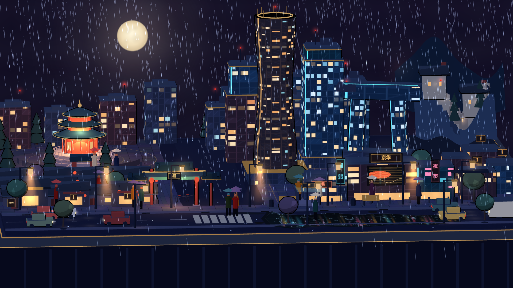
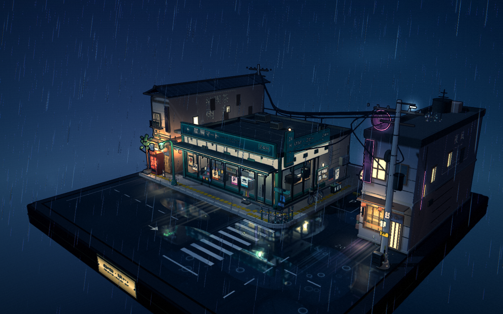
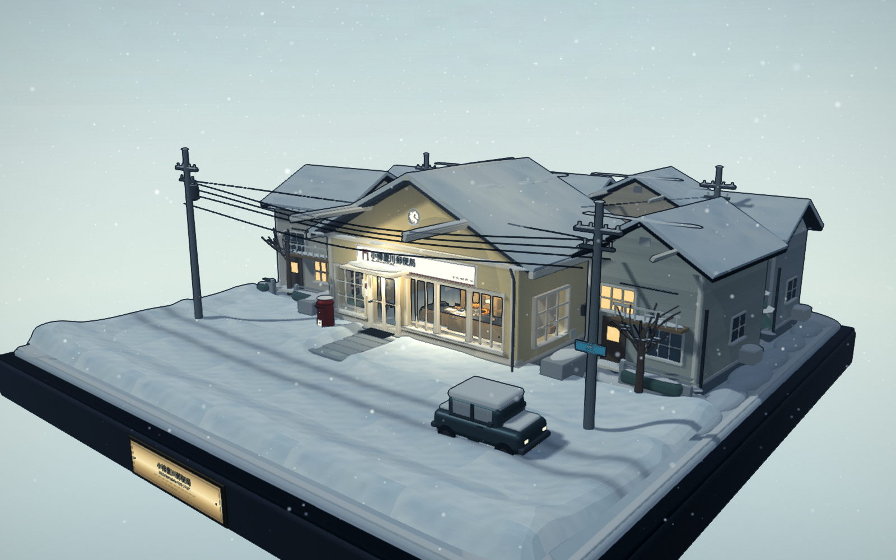
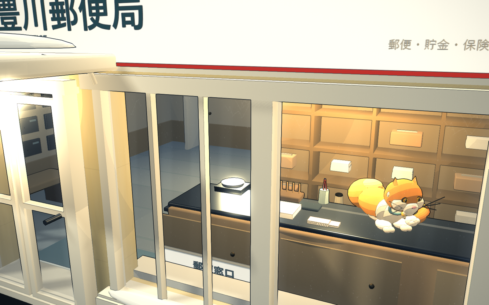

# Miniature Dioramas · 微缩沙盘作品集

四个用 **three.js** 手写着色器搭建的浏览器端微缩场景：一座会下雨也会下雪的北京城、
一间夜雨里的街角便利店、一间雪夜森林小屋，还有一座冬日的小樽邮局。
全部是纯前端静态页面，**双击 HTML 即可运行**，不需要构建、不需要联网。

<p>
  
  
</p>
<p>
  
  
</p>
<p>
  
  
  
</p>

## 目录

| 目录 | 作品 | 说明 |
|---|---|---|
| `01-beijing-night/` | **京华夜梦 · 北京微缩沙盘** | 城市微缩沙盘，可在雨夜与雪夜两种天气间切换，固定轨道相机环视 |
| `02-hoshikuzu-mart/` | **夜雨の街角 · STARDUST MART** | 雨夜街角的便利店小景，湿地面反光、霓虹灯牌、雨丝与积水涟漪 |
| `03-snow-cabin/` | **雪夜森林小屋 · PINE HOLLOW** | 松林里的木屋，屋内有壁炉火光，屋外落雪与冷雾 |
| `04-otaru-post-office/` | **小樽豊川郵便局 · 冬日雪景** | 北海道小樽的邮局建筑，含室内陈设与一只可以靠近观察的猫 |

## 直接观看

每个作品目录里都有一个**已内联打包好的单文件 HTML**（把 three.js 与全部源码打成一个文件），
直接双击用浏览器打开即可，无需任何服务器：

```
01-beijing-night/beijing-miniature-night.html
02-hoshikuzu-mart/hoshikuzu-mart.html
03-snow-cabin/snow-cabin.html
04-otaru-post-office/otaru-post-office.html
```

> 建议用桌面版 Chrome / Edge 打开（需要 WebGL2）。手机浏览器也能运行，但性能与画面细节会下降。

## 操作

- **拖拽**：旋转视角（轨道相机）
- **滚轮 / 双指捏合**：拉近拉远
- 部分场景带**开场动画**，点击或滚动即可跳过

## 从源码构建

`02`、`03`、`04` 保留了完整可编辑源码（ES modules + 自写 GLSL 着色器）：

```
02-hoshikuzu-mart/     index.html  src/*.js  package.json  build-inline.mjs
03-snow-cabin/         index.html  src/*.js  package.json  build-inline.mjs
04-otaru-post-office/  index.html  src/*.js  package.json  build-inline.mjs
```

```bash
cd 02-hoshikuzu-mart
npm install          # 只装 esbuild / three / playwright-core
npm run build        # 把 src/main.js 打包成 src/app.js
npm run inline       # 把 app.js 与 three.js 内联进单个 HTML
```

用任意静态服务器打开 `index.html` 就能调试源码版本（`src/` 走 ES module，`file://` 打开会被
浏览器的模块跨域策略拦住）。`04-otaru-post-office/tools/` 里是开发期间用来截图和校准构图的
Playwright 脚本，与最终成品无关。

## 技术要点

- 全部为 **three.js + 手写 GLSL**：雪、雨、湿地面、霓虹、体积雾、水面涟漪都是自定义着色器，
  没有使用任何贴图素材或第三方模型
- 每个场景是**一次性内联产物**：three.js 运行时与业务代码一起打进 HTML，保证单个文件可离线打开
- 场景由代码程序化建模（`base.js` / `neighborhood.js` / `streetProps.js` / `cabin*.js` /
  `postOffice*.js` 等），没有外部美术资源依赖

## 许可

代码以 MIT 许可发布；three.js 为 MIT（© three.js authors）。